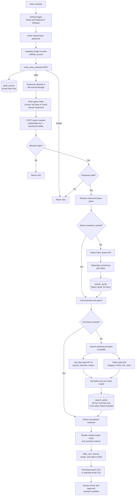

# Steam Radar: Complete Project Walkthrough

This document explains Steam Radar from the moment a team member opens the website to the moment they export a creator list. It includes a plain-language explanation for marketing and leadership, a technical explanation for developers, an architecture diagram, and a copy-ready prompt for generating a polished visual document.

## 1. Project in one sentence

Steam Radar turns a game name into a research report of relevant YouTube videos, Twitch VODs, and Twitch live streams so a game-marketing team can compare creators, find public contact information, and export outreach data.

## 2. What problem Steam Radar solves

Creator discovery is often manual. A marketer searches several platforms, checks whether the result is about the correct game, opens many creator profiles, compares performance, looks for contact information, and copies useful records into a spreadsheet.

Steam Radar combines those research steps into one controlled team workflow:

1. Unlock the private team tool.
2. Enter the name of a Steam game.
3. Resolve the correct Steam title and app ID.
4. Search YouTube, Twitch, or both.
5. Normalize different platform data into comparable creator cards.
6. Filter, sort, and review the results.
7. Select creators with public email addresses.
8. Export a report or contact list for the studio's approved outreach process.

Steam Radar accelerates research and list preparation. It does not decide creator fit, send email, run a campaign, or replace human review.

## 3. Non-technical explanation: the complete user journey

### Step 1: Open the team website

The user opens:

`https://three-coins-studio.github.io/steam-radar/`

GitHub Pages serves the interface. The screen first asks for the shared Steam Radar team password.

### Step 2: Unlock Steam Radar

The password is sent over HTTPS to the backend for verification. The backend compares it with a protected bcrypt hash stored in Supabase Postgres. The original password is not stored in the database.

After a successful check, the browser keeps the password in `sessionStorage`, which is limited to the current browser-tab session. Selecting **Lock** removes it and reloads the page. Every search request is checked again, so changing the team password invalidates old tabs on their next request.

This is a shared team-password gate, not an individual user-account system. It does not identify which teammate performed a search.

### Step 3: Enter a game name

The user types a Steam game name, not a store URL. For example:

```text
Risk of Rain 2
```

Steam Radar searches the Steam Store API, scores the returned titles, avoids likely DLC, demos, soundtracks, and tools, and chooses the strongest app match. It then attempts to enrich that match with SteamSpy metadata.

The Steam Store title is treated as the canonical name. That name is used for the YouTube and Twitch searches.

### Step 4: Choose platforms and result size

The user can enable:

- YouTube.
- Twitch.
- Both YouTube and Twitch.

TikTok and X appear as future sources but are not currently searchable.

The user chooses up to 50, 100, 200, 300, or 500 results per selected source. Larger searches take longer, consume more provider quota, and can return more noise.

### Step 5: Search the content platforms

The backend searches the selected providers in parallel.

For YouTube, it searches for `<canonical game name> gameplay`, then adds public channel and video details.

For Twitch, it resolves the matching Twitch game category, retrieves recent or relevant VODs, retrieves live streams, and enriches them with public creator profile data.

If one provider fails and the other succeeds, Steam Radar still displays the successful results and shows a warning. If all selected providers fail, the search returns an error.

### Step 6: Review the discovery report

YouTube and Twitch results use a common card layout so the team can compare them in one grid.

A card can show:

- Platform and content type.
- Thumbnail and content title.
- Creator or channel name.
- Publication date or **Live now** status.
- Views or current live viewers.
- Likes and comments for YouTube.
- Duration and language for Twitch.
- A link to the content.
- Whether a public email address was found.

The report also summarizes the visible result count, total views, average YouTube-style like rate, and number of public emails.

### Step 7: Filter and sort the results

The user can:

- Search within titles and creator names.
- Show all results, only results with an email, or only results without an email.
- Show Shorts or long-form results.
- Sort by views, newest date, or best like rate.
- Remove irrelevant cards and restore them later.

These actions run in the browser on the results already returned. They do not repeat the provider search.

### Step 8: Select public emails

When a public email is available, the user can select it from the creator card. Email selection is case-insensitive, so differently capitalized versions of the same address count as one selection.

For YouTube, the backend looks for an email-shaped value in API-visible channel description and branding metadata. For Twitch, it looks in public creator or content descriptions. Steam Radar does not reveal protected business-contact details or bypass platform controls.

### Step 9: Export the work

The user can download:

- A CSV report containing the currently visible creator results.
- A selected-email CSV containing creator and source information.

The exported file is the boundary of the current product. Steam Radar does not send outreach messages. The team should review, clean, enrich, and approve the list before using its normal CRM or email process.

## 4. End-to-end architecture diagram



## 5. Technical explanation

### 5.1 Frontend and hosting

The production frontend is a static GitHub Pages site built from `index.html` and `config.js`.

`index.html` loads pinned browser builds of React 18.3.1, ReactDOM 18.3.1, Material UI 5.16.7, and Babel Standalone 7.25.2. JSX is compiled in the browser, so there is no Node build pipeline for the current frontend.

`config.js` contains the Supabase Edge Function URL and a low-privilege Supabase publishable key. The publishable key identifies the public browser application. It is not the provider credential and is not the Supabase secret/service-role key. YouTube and Twitch secrets remain in the Edge Function environment.

### 5.2 Shared-password access control

The page initially renders `PasswordRoot`. If no password exists in the current tab, it renders `PasswordLoginPage`.

Unlock flow:

1. The browser sends `POST` to the Edge Function with `{ "action": "validate_access" }`.
2. The request includes the public Supabase key in `apikey` and the candidate team password in `X-Access-Password`.
3. The Edge Function creates a server-side Supabase client using a secret key, falling back to the legacy service-role key when necessary.
4. It calls the restricted `verify_team_password` Postgres function.
5. The function uses `pgcrypto` to compare the candidate with the bcrypt hash in `team_access`.
6. A valid password is saved to browser-tab `sessionStorage`; an invalid request receives HTTP 401.

The Edge Function has platform JWT verification disabled because it performs custom password authorization. The publishable key is still supplied to the Supabase gateway, but access to the search operation depends on the custom password check.

### 5.3 CORS and request validation

The Edge Function accepts only `POST` and `OPTIONS`. It compares the request origin with the comma-separated `ALLOWED_ORIGINS` secret. A browser origin outside that list receives HTTP 403.

The search handler validates the game name, selected platforms, result count, date filter, and language. The current interface sends `date_filter: "all"` and `language: "en"`; the backend supports other values for future UI controls.

### 5.4 Steam resolution

`resolveSteamGame`:

1. Normalizes whitespace and validates a 2–120 character query.
2. Checks a versioned Steam-resolution cache key.
3. Calls Steam Store `api/storesearch` when the cache misses.
4. Filters to apps and ranks candidates using exact match, token overlap, prefix bonus, missing/extra token penalties, and an add-on penalty.
5. Calls SteamSpy `appdetails` as optional enrichment.
6. Keeps Steam's current store title as authoritative.
7. Caches the resolved game for 24 hours.

If SteamSpy fails, the Steam match remains usable.

### 5.5 YouTube provider pipeline

YouTube credentials come from the Edge Function's `YOUTUBE_API_KEY` secret.

The pipeline calls `search.list` for `<game name> gameplay`, paginates in groups of up to 50, deduplicates video IDs, calls `channels.list` and `videos.list` in batches of 50, converts ISO 8601 durations, extracts the first public email-shaped value, calculates `likes / views × 100`, and marks content of 60 seconds or less as a Short.

### 5.6 Twitch provider pipeline

Twitch credentials come from `TWITCH_CLIENT_ID` and `TWITCH_CLIENT_SECRET` secrets. The function obtains an app access token with the client-credentials flow and caches it in a warm function instance. A provider 401 triggers one forced refresh and retry.

The pipeline tries an exact game-category lookup, falls back to scored category search, retrieves VODs, retrieves live streams, fetches creator profiles in batches of 100 IDs, extracts the first public email-shaped value, converts Twitch durations, and combines live and recorded results up to the requested maximum.

Twitch does not provide the same fields as YouTube. Live Twitch results use current viewer count; this implementation does not supply YouTube-style likes, comments, like ratio, subscriber count, or country for Twitch.

### 5.7 Parallel execution and partial failure

Selected providers run through `Promise.allSettled`. Successful results are combined and failed providers are recorded in `provider_errors`. If at least one provider succeeds, the frontend shows results with a warning. If no provider returns results and errors exist, the function responds with HTTP 502.

### 5.8 Search caching

The backend hashes a versioned normalized request containing the app ID, canonical name, sorted platforms, result limit, date filter, and language.

| Cached data | Time to live |
| --- | --- |
| Steam game resolution | 24 hours |
| YouTube-only content search | 30 minutes |
| Search containing Twitch | 2 minutes |

The `search_cache` table has RLS enabled. Access is revoked from `anon` and `authenticated`; server-side access uses the elevated backend key.

### 5.9 Normalized result model

Both providers are transformed into a shared structure:

```text
platform, content_type, is_live, video_id, title, thumbnail,
channel_name, channel_id, channel_url, video_url, published_at,
description, email, country, language, view_count, viewer_count,
like_count, comment_count, like_ratio, duration_seconds,
subscriber_count, is_short
```

Provider-specific fields use neutral values when unavailable. This enables one card, filter system, and export workflow for both platforms.

### 5.10 Frontend state, filters, and exports

React keeps the game query, canonical title, selected platforms, limit, returned videos, loading/errors, removed IDs, and selected emails in memory. The results view adds text, email, content-type, and sort filters. Refreshing clears this working state.

CSV files are generated in the browser using `Blob` object URLs. The visible report exports the filtered grid. The floating selected-email export deduplicates case-insensitively and includes platform and representative content.

The interface also contains a second selected-email export inside the report. It serializes matching result rows, so one address can repeat when several results share it. This is a known consistency issue; use the floating export and review every file before outreach.

### 5.11 Local Flask fallback

`app.py` is a maintainer-oriented fallback that serves the interface, resolves games through Steam and SteamSpy, searches YouTube with `SEARCHAPI_KEY` from `.env`, and exposes `/api/scrape` plus `/api/health`.

When `config.js` contains the hosted URL, a locally served frontend still uses Supabase and the password gate. Maintainers must intentionally run without that hosted configuration to exercise Flask. Twitch is not implemented in Flask.

## 6. Data stores and trust boundaries

| Component | Stores | Does not store |
| --- | --- | --- |
| Browser tab | Shared password in `sessionStorage`; temporary results and selections in memory | Provider secrets, permanent creator database |
| GitHub Pages | Static code, public endpoint URL, publishable key | Password, provider credentials, Supabase secret key |
| Supabase Postgres | Bcrypt password hash; temporary cached responses | Plaintext team password |
| Edge Function secrets | YouTube key, Twitch credentials, allowed origins | Public frontend state |
| Downloaded CSV | Data explicitly exported by the user | Automatic CRM or email state |

## 7. Security and responsible use

- The public Supabase key is intentionally publishable; elevated keys must remain server-side.
- The shared password should be long, distributed securely, and rotated when access changes.
- Password verification and provider calls happen server-side.
- Allowed origins, RLS, and revoked table privileges add defense in depth.
- Only public creator metadata is processed.
- An email-shaped string may be outdated or inappropriate for marketing; every contact requires review.
- The studio remains responsible for privacy, anti-spam, consent, platform, and regional outreach rules.

## 8. Current limitations

- Shared access has no individual identity, roles, audit trail, or per-user revocation.
- Game matching is heuristic and can choose the wrong edition.
- TikTok and X are placeholders only.
- The UI always requests all dates and English; supported backend filters are not exposed.
- YouTube uses a fixed `gameplay` search term.
- Platform metrics are not fully equivalent.
- Many creators publish no API-visible email; only the first matching string is retained.
- Cached results can briefly lag provider data.
- Results and selections disappear on refresh.
- The two selected-email export controls are not identical.
- There is no CRM, campaign history, notes, response tracking, or email sender.

## 9. Recommended marketing workflow

1. Search the canonical game across both supported platforms.
2. Narrow the report to the campaign's content profile.
3. Open promising source links and review brand fit.
4. Select relevant public addresses.
5. Export and inspect the list for duplicates and incorrect contacts.
6. Enrich it with campaign-specific information.
7. Obtain required approval.
8. Conduct outreach through approved studio systems.

The tool produces candidates, not automatic endorsements.

## 10. Copy-ready prompt for a visual document generator

```text
Create a polished project-explainer document titled “Steam Radar: From Game Name to Creator Outreach List.” The audience includes game-marketing staff, studio leadership, and developers. Use a premium dark gaming-analytics style with plum and mauve backgrounds, coral highlights, cream text, subtle platform accents, accessible contrast, and clean arrows.

Begin with this plain-language summary: Steam Radar is a password-protected team tool hosted on GitHub Pages. A user enters a Steam game name, chooses YouTube, Twitch, or both, and chooses a result limit. A Supabase Edge Function verifies the shared password, resolves the canonical game through Steam Store search, enriches it with SteamSpy when available, searches the selected providers, normalizes results, and returns a creator report. The user filters and reviews cards, selects publicly listed emails, and exports CSV files. The tool does not reveal private contacts, send email, or replace human creator-fit review.

Create one main left-to-right diagram with four swimlanes:

1. Team Member: open site; enter team password; type game name; choose YouTube/Twitch/both; choose 50–500 results per source; review/filter/sort/remove; select public emails; export report CSV or selected-email CSV.

2. Browser / GitHub Pages: React 18 and Material UI in index.html; public function URL and publishable key in config.js; password in tab sessionStorage; POST with apikey and X-Access-Password; temporary results and selections in memory; browser-generated CSV.

3. Supabase Backend: allowed-origin CORS check; password verification through a server-only RPC; team_access with one bcrypt hash; Steam Store resolution plus best-effort SteamSpy; 24-hour game cache; SHA-256 search cache key; cache-hit/cache-miss decision; selected providers in parallel with Promise.allSettled; one normalized model; 30-minute YouTube-only cache and 2-minute Twitch-included cache; partial-provider warning behavior.

4. External Services and Output: Steam Store Search API; SteamSpy; YouTube Data API v3 search/channels/videos; Twitch OAuth and Helix games/videos/streams/users; report CSV; selected-email CSV; human review and approved outreach.

Show unlock before search. Add valid/invalid password and cache hit/miss decisions. Show YouTube and Twitch as parallel branches merging into a normalized response. Show database cylinders for team_access and search_cache and locks for password verification and secrets.

Add callouts:
- config.js contains public client configuration only; provider and Supabase secrets stay server-side.
- The browser password is tab-scoped but remains sensitive.
- Only public API-visible creator metadata is inspected.
- YouTube and Twitch metrics are not fully equivalent.
- Caching protects quota and response time but can briefly serve older data.
- TikTok and X are planned placeholders, not active providers.

After the diagram, add “For Marketing and Leadership” and “For Developers” sections. The technical section must explain React/Material UI, config.js, the custom password gate, sessionStorage, publishable versus secret keys, Edge Function CORS, verify_team_password, bcrypt/pgcrypto, RLS, Steam resolution scoring, SteamSpy fallback, provider parallelism, YouTube pagination and 50-ID batches, Twitch token refresh and 100-ID user batches, normalized fields, SHA-256 cache keys, cache TTLs, partial errors, browser state, exports, and the YouTube-only Flask fallback.

Finish with architecture and trust-boundary tables, limitations, a glossary, and this closing statement: “Steam Radar accelerates creator discovery and list preparation; people remain responsible for creator fit, contact validation, and outreach decisions.”
```

## 11. Glossary

| Term | Meaning |
| --- | --- |
| API | A controlled interface through which one system requests data from another. |
| Edge Function | Server-side TypeScript code deployed on Supabase infrastructure. |
| Publishable key | A low-privilege Supabase key designed for public client code. |
| Secret key | An elevated backend key that must never be exposed publicly. |
| bcrypt | A password-hashing algorithm designed to make guessing expensive. |
| RLS | Postgres Row Level Security. |
| CORS | Browser rules controlling which website origins may call an API. |
| Quota | A provider's API usage allowance. |
| Pagination | Retrieving a result set through multiple response pages. |
| Cache TTL | How long a cached response remains valid. |
| Metadata | Descriptive public data such as title, creator, date, or category. |
| `sessionStorage` | Browser storage normally limited to one tab session. |
| CSV | A spreadsheet-friendly text export format. |
| VOD | Previously recorded Twitch content rather than a live stream. |
| Canonical game title | The authoritative Steam Store name chosen for the query. |

